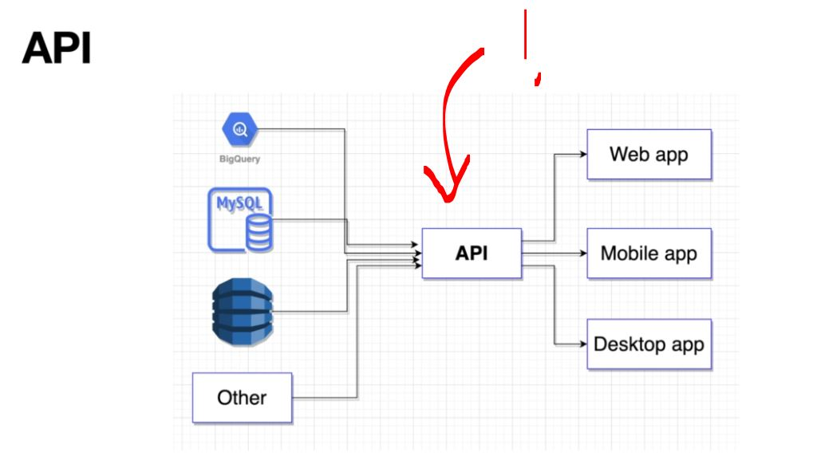
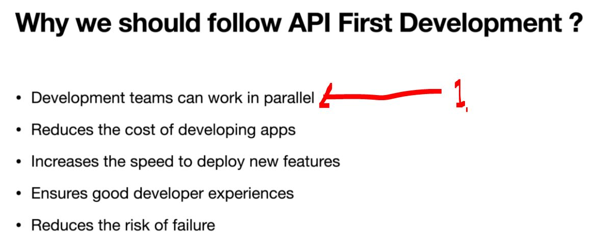
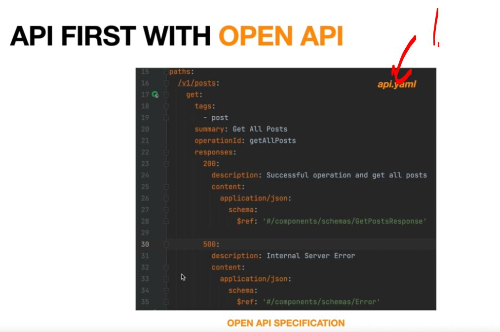
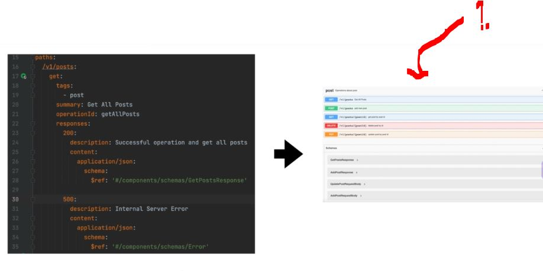
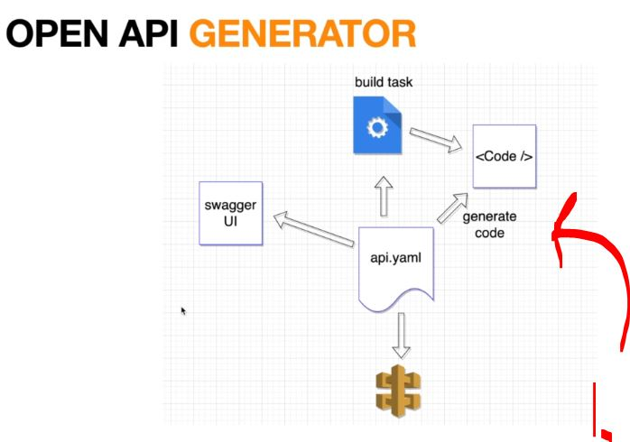
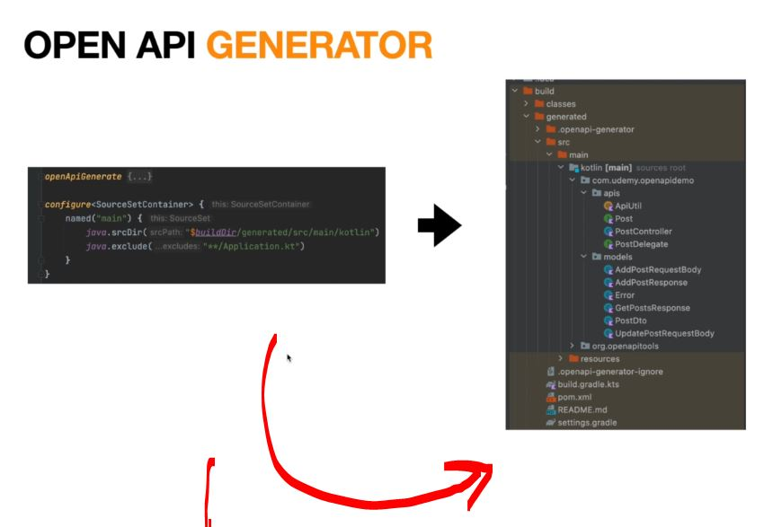

# Section 01: Introduction. 

Introduction.

# What I learned.

# Introduction.

    

1. We define API in one place.

    

1. Work can be worked independently!

    

1. We can just make `.yaml` file!
    - Here in case of success `200` and failure `500`!

    

1. We can generate the document easily!

    

1. Open API will provide **multiple generators** for generated code! 

    

1. `OpenApiGenerate()` will generate these **Open API based classes**!

# Source Code.

- Delegate Pattern Code: `https://github.com/Vikas-Kumar56/api-driven-development`

- InterfaceOnly: `https://github.com/Vikas-Kumar56/api-driven-development/tree/interface-only-impl`