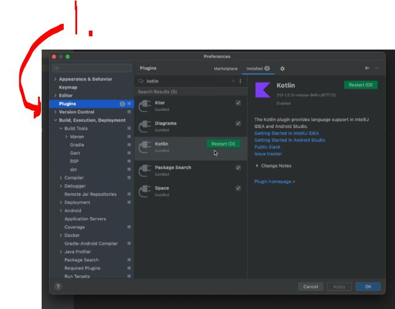

# Section 02: Open API Specification Explained. 

Open API Specification Explained.

# What I learned.

# Setup Spring Boot Kotlin Application. ✅
  
<div 
align="center">
    
</div>

1. We are creating the **spring project** as following:

# Starting Spring boot Application and Install JDK and Kotlin Plugin. ✅

<div 
align="center">
    
</div>

1. I did not need to install the plugin for the Kotlin! One can check if this is needed!

# Adding General Info of Application Using OpenAPI Yaml. ✅

- We can write our interface:

````Yaml
# What version of Open API we will be using.
openapi: 3.0.1
info:
  title: API Driven development Demo!
  version: 1.0.0
  description: "Tutorial for api first development"

# Servers is array.
servers:
  - url: /api/
    description: base url for dev env.

tags:
  - name: post
    description: Operations about the post.
````

- Key points:
    - `openapi: 3.0.1` — Specifies the **OpenAPI specification** version.
    - `info` — Defines the **API title**, **version**, and **description**.
    - `servers` — lists the **base URL** for the API. The relative URL `/api/` uses the current host.
        > It's called **server** because it refers to the servers (computer systems) that host and run your API!
    - `tags` — defines a `post` category for grouping related API operations in the documentation.

# Explained Paths And Added First EndPoint Using Specification. ✅

- Never add version into the **base URL**:
    ````Yaml
    # Servers is array.
    servers:
    - url: /api/
        description: base url for dev env.
    ````

- We will define following **Yaml**:

````Yaml
paths:
  /v1/posts:
    get:
      tags:
        - post
      summary: Get All Posts
      operationId: getAllPosts
      responses:
        '200':
          description: Successfully retrieved all posts
          content:
            application/json:
              schema:
                type: object
                properties:
                  posts:
                    type: array
                    items:
                      type: object
                      properties:
                        id:
                          type: string
                          format: uuid
                        title:
                          type: string
                        description:
                          type: string
                        authorName:
                          type: string
````

- `paths` — defines the available API endpoints.
    - `/v1/posts` — the endpoint for accessing posts.
        - `get` — retrieves data without creating or modifying a resource.
            - `tags` — groups this endpoint under the post category in API documentation.
            - `summary` — provides a short explanation of the operation.
            - `operationId` — gives the **operation a unique identifier**, useful for generating client code.
                - Is a **unique name given** to an **API operation** (endpoint action).
            - `responses` — defines the possible responses the API can return.
                - `200` — the HTTP status code for a successful request.
                    - `description` — explains what happened: all posts were retrieved successfully.
                    - `content` — describes the format of the response body.
                        - `application/json` — says the response data is JSON.
                            - `schema` — defines the structure of the response data.
                                - `type:` object — says the response body is a JSON object.
                                    - `format` UUID indicates that the text should follow the UUID format.

# Reuse Model Definition With Components Field. ✅

> [!NOTE]  
>
> 📝 One should **use components** whenever it helps you reuse definitions > and keep your **OpenAPI specification** maintainable, but one should put everything into components! 📝

- `components` — stores reusable definitions for your API, such as schemas, responses, and parameters. We will be **re-use components**:
    ```Yaml
    components:
    schemas:
        Post:
        type: object
        properties:
            id:
            type: string
            format: uuid
            title:
            type: string
            description:
            type: string
            authorName:
            type: string
    ```
    - And them we will refer to this with the `$ref: '#/components/schemas/Post'`!
        - `$ref:` A keyword used to **reference another schema** or **component**.
        - `#:` Refers to the **current document**.
        - `/components/schemas/Post`: The path to the schema named Post inside components.schemas.

- We will use this **component** as following:
    ````Yaml
    paths:
    /v1/posts:
        get:
        tags:
            - post
        summary: Get All Posts
        operationId: getAllPosts
        responses:
            '200':
            description: Successfully retrieved all posts
            content:
                application/json:
                schema:
                    type: object
                    properties:
                    posts:
                        type: array
                        items:
                        $ref: '#/components/schemas/Post'
    ````

# Adding Other Http Status For Get Request endpoint. ✅

- We will make the **YAML** `GeneralError`!
    ````Yaml
    components:
    schemas:
        GeneralError:
        type: object
        properties:
            code:
            type: integer
            format: int32
            message:
            type: string
    ````
- We will refer to this in case of an error:
    ````Yaml
    paths:
    /v1/posts:
        get:
        tags:
            - post
        summary: Get All Posts
        operationId: getAllPosts
        responses:
            '500':
            description: Internal Server Error
            content:
                application/json:
                schema:
                    $ref: '#/components/schemas/GeneralError'
    ````

# Path Variable Declaration With Open API - getByPostId endpoint.

- We will be making this endpoint:

````Yaml
paths:
  /v1/posts/{postId}:
    get:
      tag:
        - post
      summary: get post by post id
      operationId: getPostById
      parameters:
       - name: postId
         in: path
         description: postId of post that needs to be fetched!
         required: true
         schema:
           type: string
           format: uuid
      responses:
        200:
          description: Successful operation
          content:
            application/json:
              schema:
                $ref: '#/components/schemas/Post'
        400:
          description: Not found - increase post id value!
          content:
            application/json:
              schema:
                $ref: '#/components/schemas/Error'
        500:
          description: Internal server error!
          content:
            application/json:
              schema:
                $ref: '#/components/schemas/Error'
````

- parameters: defines these parameters to the endpoint! 
    - name: `postId` name of the parameter!
    - `in` is defining where this parameter will be **receding in**!
                - `path` — Parameter is in the URL path. Example: `/posts/123`!
                - `query` — Parameter comes after ? in the URL. Example: `/posts?page=2`!
                - `header` — Parameter is sent in the HTTP headers. Example: Authorization: Bearer token!
                - `cookie` — Parameter is sent in a cookie!

# Http Post Method With Open API. ✅

- We will be learning how to create POST endpoint!

````Yaml

````

- todo this, which is needed

# Http Delete Method - Open API.

- We will define to delete definition:

````Yaml
    delete:
      tags:
        - post
      summary: delete post by id
      operationId: deletePostById
      parameters:
        - $ref: '#/components/parameters/PostIdPathVariable'
      responses:
        204:
          description: successful operation
        404:
          description: not found - incase post id not valid
          content:
            application/json:
              schema:
                $ref: '#/components/schemas/Error'
        500:
          description: Internal server error
          content:
            application/json:
              schema:
                $ref: '#/components/schemas/Error'
````


# Refactor - Path Variable - OpenAPI.

- todo

# Http Put definition - Open API.

-todo

# Request Body Required Validation.

<details>
<summary 
id="Yaml_For_API"
open="true"> <b>The .Yaml defination for this API!<b> </summary>


````Yaml
openapi: 3.0.1
info:
  title: API Driven development Demo
  version: 1.0.0
  description: 'Tutorial for api first development'

servers:
  - url: /api
    description: base url for dev env

tags:
  - name: post
    description: Operations about post

paths:
  /v1/posts:
    get:
      tags:
        - post
      summary: Get All Posts
      operationId: getAllPosts
      responses:
        200:
          description: Successful operation and get all posts
          content:
            application/json:
              schema:
                $ref: '#/components/schemas/GetPostsResponse'

        500:
          description: Internal Server Error
          content:
            application/json:
              schema:
                $ref: '#/components/schemas/Error'
    post:
      tags:
        - post
      summary: add new post
      operationId: addPost
      requestBody:
        required: true
        content:
          application/json:
            schema:
              $ref: '#/components/schemas/AddPostRequestBody'
      responses:
        201:
          description: successful operation
          content:
            application/json:
              schema:
                $ref: '#/components/schemas/AddPostResponse'
        400:
          description: bad request
          content:
            application/json:
              schema:
                $ref: '#/components/schemas/Error'
        500:
          description: internal server error
          content:
            application/json:
              schema:
                $ref: '#/components/schemas/Error'

  /v1/posts/{postId}:
    get:
      tags:
        - post
      summary: get post by post id
      operationId: getPostById
      parameters:
        - $ref: '#/components/parameters/PostIdPathVariable'
      responses:
        200:
          description: successful operation
          content:
            application/json:
              schema:
                $ref: '#/components/schemas/PostDto'
        404:
          description: not found - incase post id not valid
          content:
            application/json:
              schema:
                $ref: '#/components/schemas/Error'
        500:
          description: Internal server error
          content:
            application/json:
              schema:
                $ref: '#/components/schemas/Error'
    delete:
      tags:
        - post
      summary: delete post by id
      operationId: deletePostById
      parameters:
        - $ref: '#/components/parameters/PostIdPathVariable'
      responses:
        204:
          description: successful operation
        404:
          description: not found - incase post id not valid
          content:
            application/json:
              schema:
                $ref: '#/components/schemas/Error'
        500:
          description: Internal server error
          content:
            application/json:
              schema:
                $ref: '#/components/schemas/Error'
    put:
      tags:
        - post
      summary: update post by post id
      operationId: updatePostById
      parameters:
        - $ref: '#/components/parameters/PostIdPathVariable'
      requestBody:
        required: true
        content:
          application/json:
            schema:
              $ref: '#/components/schemas/UpdatePostRequestBody'
      responses:
        204:
          description: successful operation
        404:
          description: not found - incase post id not valid
          content:
            application/json:
              schema:
                $ref: '#/components/schemas/Error'
        400:
          description: bad request
          content:
            application/json:
              schema:
                $ref: '#/components/schemas/Error'
        500:
          description: Internal server error
          content:
            application/json:
              schema:
                $ref: '#/components/schemas/Error'


components:
  parameters:
    PostIdPathVariable:
      name: postId
      in: path
      description: The postid of post that needs to be deleted
      required: true
      schema:
        type: string
        format: uuid
  schemas:
    GetPostsResponse:
      type: object
      properties:
        posts:
          type: array
          items:
            $ref: '#/components/schemas/PostDto'
    AddPostResponse:
      type: object
      required:
        - postId
      properties:
        postId:
          type: string
          format: uuid
    UpdatePostRequestBody:
      type: object
      properties:
        title:
          type: string
        description:
          type: string
    AddPostRequestBody:
      type: object
      required:
        - title
        - authorName
      properties:
        title:
          type: string
        description:
          type: string
        authorName:
          type: string
    PostDto:
      type: object
      properties:
        id:
          type: string
          format: uuid
        title:
          type: string
        description:
          type: string
        authorName:
          type: string

    Error:
      type: object
      properties:
        code:
          type: integer
          format: int32
        message:
          type: string
````
</details>
