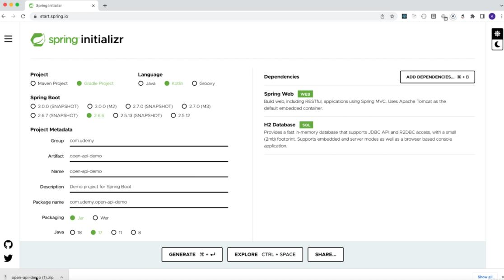

# Section 02: Open API Specification Explained. 

Open API Specification Explained.

# What I learned.

# Setup Spring Boot Kotlin Application.
  

    

1. We are creating the **spring project** as following:

# Starting Spring boot Application and Install JDK and Kotlin Plugin.

# Adding General Info of Application Using OpenAPI Yaml.

# Explained Paths And Added First EndPoint Using Specification.

# Reuse Model Definition With Components Field.

# Adding Other Http Status For Get Request endpoint.

# Path Variable Declaration With Open API - getByPostId endpoint.

# Http Post Method With Open API.

# Http Delete Method - Open API.

# Refactor - Path Variable - OpenAPI.

# Http Put definition - Open API.

# Request Body Required Validation.