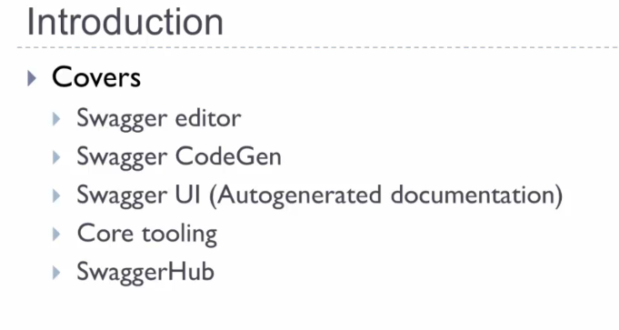
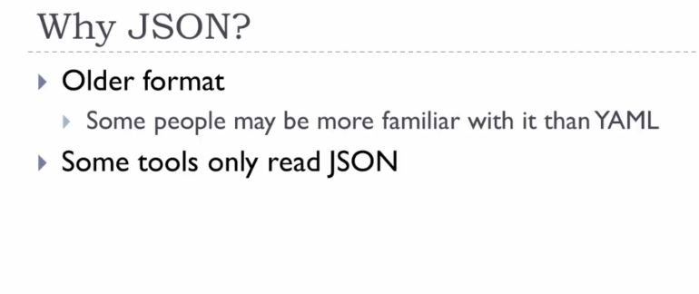
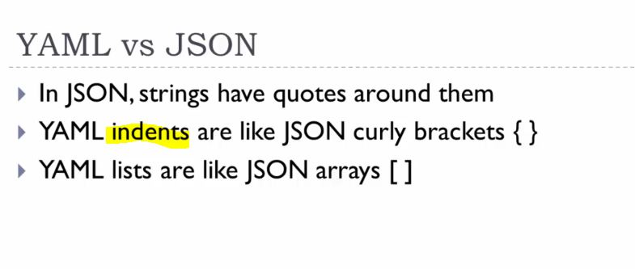
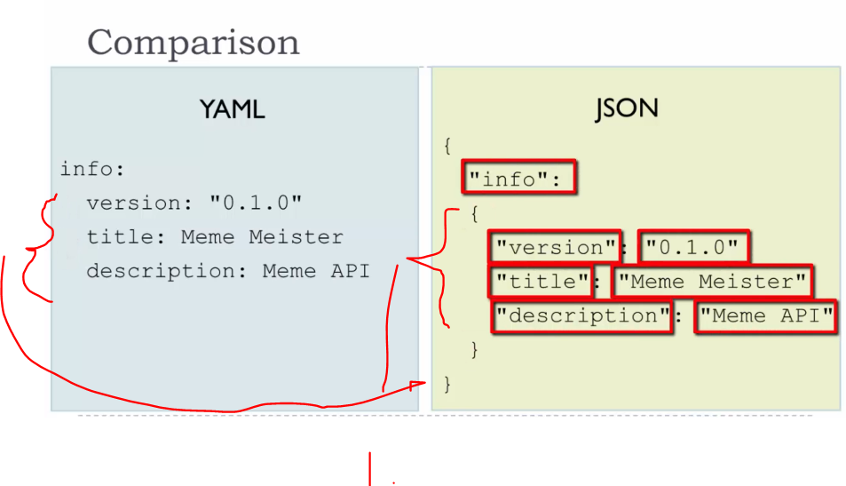
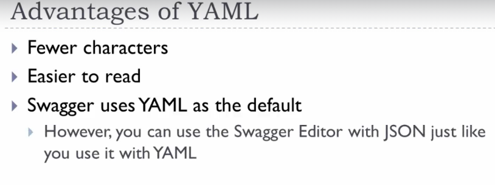

# Tools and Alternatives.

Tools and Alternatives.

# What I learned.

# Swagger Tools. ✅



- **Swagger Editor**, syntax etc...
- **Swagger Codegen**
    - Take **OAS** and generates **SDK** out of the file.
- **Swagger UI** auto generated UI documentation etc...

- You can **host** these tools on your own platform.
- **Paid** is **SwaggerHub**, these are hosted somewhere else.

# Assignment 06: SwaggerHub.

```
SwaggerHub is commercial platform.
```

# JSON. ✅

- **OAS** file can be created with `yaml` or `json`.



1. **JSON** is older format.



- Remember **yaml** has indentation.



1. You can have same indentation, but with `{}`.

- There will be many other syntax things, but you need to check the documentation.
    - [Link](https://yaml.org/).



1. **Swagger** uses `yaml` by default.


# Assignment 07: Put It All Together.

- Todo


# Assignment 08: Swagger for a Real World API

- Todo


# Alternatives to Swagger and OAS. ✅

- Checked ✅.

# Resources. ✅

- Checked ✅.

# Bonus Lecture: Offers for Other Courses. ✅

- Checked ✅.